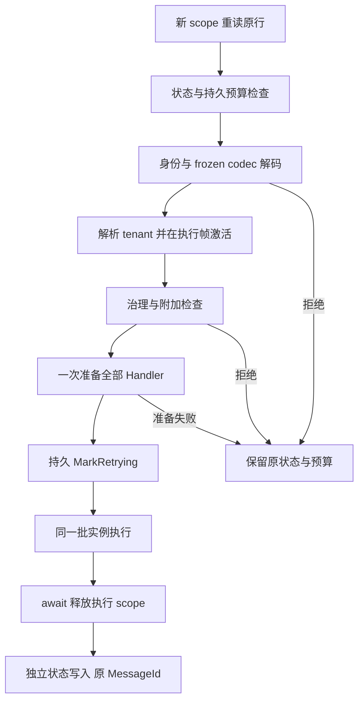

# #146 LocalEvent 框架能力补全 — 详细设计 rev.2

- 日期：2026-10-14（Asia/Shanghai）；rev.2 同日，响应 PR #148 设计审查 R1。
- Issue：[#146](https://github.com/OrchesAdam/CrestCreates/issues/146)，总控 #121。
- 设计基线：远端 master `5d3de8c544cfc888aca23124303494929c4a1c2c`（PR #145 合并），已通过 GitHub 合并信息及 `git ls-remote` 双重核对。
- 状态：**rev.2 修订完成，待复审；尚未实现，未运行本设计新增验收测试。**
- rev.3 修订（2026-10-14，对照 PR #148 S4 复审 S4-R1-LE146-03）：同步已接受的治理装配与 readiness 契约——§3.3.1 改为 Host 显式 `AddCrestLocalEventGovernance()` 装配（contracts-only 程序集只贡献声明；生成器仅在编译引用 Local runtime 时自动发出该调用），§3.3.2 增补统一五秒有界等待（含正在 bootstrap 的调用；调用方取消传播；NotReady 不缓存），§9 迁移表增补装配行。
- rev.2 修订（对照 PR #148 设计审查 R1）：
  - R1-LE146-01（P1）→ §3.3 锁定独立 LocalEvent Host 的 registry 启动责任（复用既有 EventRegistry bootstrap 的注册/驱动契约；LocalEvent-only 与 LocalEvent+RabbitMQ、两种注册顺序的有限启动/恢复验收；非 hosted 契约不阻塞、不缓存）；新增验收 G06/G07。
  - R1-LE146-02（P2）→ §7.2 明确"非空持久 CorrelationId 必须恢复、缺能力执行前拒绝、无声明开关、不静默降级"；基线夹具补齐 tenant/correlation 设施并区分缺设施负例。
  - R1-LE146-03（P2）→ 冻结后工厂变化补独立 H03 基线（不以下列 R01/G01 替代）。
- 完整设计与实施交接已发布到 [Issue 评论](https://github.com/OrchesAdam/CrestCreates/issues/146#issuecomment-6158450713)。
- 本文落实 Issue A–D；替代 #126 Spec 中全局 codec、重复实例预检、仅在失败记录时检查治理版本的旧设计。#126 已交付的唯一 typed dispatch / replay 主链继续有效。
- 编排：#127 → #146 → #128；若 #128 已在途，先协调 CodeGenerator / JsonContracts 文件，再串行合并及重验，不要求中断在途工作。不自动合并，CI 保持暂停。

## 1. 设计结论与范围

本任务把 LocalEvent 收口为：**Host 内声明与 codec 贡献 → 不可变分发 binding → 公共执行检查 → 单次 Handler 准备 → 同一批实例执行 → 独立持久结算与释放结果**。

正常发布、Channel 消费、人工/后台重放和直接 dispatcher 都进入共同检查/准备核心。Channel 发布只做 admission 与上下文捕获，不提前构造 Handler。重放继续更新原 MessageId，禁止再调用 PublishAsync 生成第二条 DLQ。

三类能力明确分开：

| 能力 | 默认与要求 |
| --- | --- |
| 普通本地通知 | 显式 membership / Handler；无需治理 registry 或 codec。零 Handler 普通分发仍是 no-op。 |
| 可重放本地事件 | 显式 Replayable + source-generated codec + replay key/version；不自动变成治理事件。 |
| 明确治理的本地事件 | 在上述能力之上显式 Governance.Required；使用既有 EventRegistry 的精确 descriptor/version/state 检查。不能靠可选 validator 缺失而放行。 |

不加入重放并发互斥、CAS/租约、崩溃 Retrying 自动恢复、per-handler checkpoint、通用 payload migration、消息级业务事务、跨服务用户授权重建或运维 UI。不改 RabbitMQ wire、队列、重试/结算协议，不把 CAP/Outbox 合并成 LocalEvent 权威。

## 2. 已核对的代码事实

| 基线位置 | 事实 | 设计处理 |
| --- | --- | --- |
| EventBus.Abstractions/LocalEventJsonCodecRegistry.cs | static 字典、TryAdd first-wins | 归档；改 Host 所属贡献 |
| LocalEventBinding / LocalEventDispatchRegistry | frozen binding 保留 CodecFactory；合并保留首个非空工厂；集合引用未全部隔离 | 声明与 frozen binding 分离；逐项解析并锁定 metadata / 集合 |
| LocalEventInvoker / DefaultLocalEventDispatcher | Probe 后 Invoke 再解析；Transient/factory 两次构造 | Prepare 返回持有实际实例的 typed invocation |
| LocalDeadLetterReplayExecutor | 独立 probe scope；MarkRetrying 后解码并换 scope | 解码和准备先完成；同一 scope 延续至执行和释放 |
| LocalEventIdentity | assembly:type 默认键 | 保留默认；新增稳定键和独立旧 replay-key alias |
| DefaultLocalEventBus / Channel bus | 可选 validator 只在发布入口调用 | 显式策略，共同执行检查；重放和直接 dispatcher 不绕过 |
| RegistryEventValidator | 名称级最新活跃版本检查 | 不能独自证明历史指定版本可执行；补既有 registry 上的精确检查 |
| LocalEventDeadLetterRecorder / Channel queue | TenantId/CorrelationId 未携带 | 入队前快照，失败记录传入快照，执行前恢复 |
| CurrentTenant.ChangeAsync | 同步阻塞 provider；未知 tenant 可变成 null，未 fail closed | 不直接用作重放校验；await 权威 provider，再在执行帧同步 Change |
| RepositoryTenantProvider | 仅返回 Active 生命周期租户，但还可按名称 fallback | 恢复按 TenantId 请求且检查返回 Id 精确相等，禁止名称路由 |
| LocalDeadLetterEfModelTests | 当前使用 EF InMemory provider，不能证明关系数据库 DDL/事务升级 | 本任务补真实 PostgreSQL schema 升级与 store 往返证据 |
| Accountability IAuditOperationContextAccessor | Current / Push，已有 LIFO AsyncLocal 帧 | 复用关联上下文，不新建通用 ambient 框架 |

路径根分别为 `src/Runtime/Eventing/`、`src/Framework/Infrastructure/CrestCreates.MultiTenancy*/`、`src/Runtime/Audit/CrestCreates.Accountability*/`。以上是设计依据，不代表本任务已经修复。

## 3. 注册、Host 隔离与真正冻结

### 3.1 声明和执行模型分离

- 新增 `LocalEventRegistration`：builder 的声明 DTO，承载精确 Type、生成的闭合 preparer、replay/alias/策略元数据和来源。它可以携带装配期工厂，但不进入运行期索引。
- `LocalEventBinding` 成为真正 frozen 执行项：只持有静态 Type、闭合 preparer、只读集合、`JsonTypeInfo? Codec`、本地身份及策略声明；**没有 CodecFactory、provider、scope、Handler 或可变 builder 引用**。
- `ILocalEventDispatchRegistry` 仍是唯一分发/lookup 索引。binding 的 Type/key 查找不取代治理 EventRegistry。

新增 `LocalEventJsonCodecRegistration`（EventBus.Abstractions）：`PayloadType / Origin / CodecFactory`，作为当前 IServiceCollection 的显式贡献。工厂只在冻结期调用，异常包装为含来源的装配诊断。

采用 #127 的 per-Host 贡献与冲突处理方式，但**不把 LocalEvent codec 和 Integration wire codec 放进同一个 Type→codec 名字空间**：LocalEvent 现有 JSON 命名策略保持原样；同一 CLR Type 可能有不同的持久本地格式和 RabbitMQ camelCase 格式，不能因复用表而相互覆盖。

### 3.2 生成与手工装配

1. 既有 JsonContracts BuildTasks 在 CoreCompile 前生成 LocalEvent JSON roots、官方 STJ context、`LocalEventJsonCodecContributions.AddCodecs(IServiceCollection)`。
2. 事件所属程序集的 `AddLocalEvents()` 静态调用本程序集 AddCodecs；handler-only 程序集只贡献分发声明。两者不通过全局表互相发现。
3. SG 生成 membership、required manifest、closed preparer、键/alias/策略常量；不能指望读取另一 SG 的同轮输出，也不直接引用外程序集 internal JSON context。
4. 手工 `Declare<TEvent>(...)` 与 typed codec 参数进入同一贡献集合；typeof 非泛型声明只承载 membership/codec，不能凭它 runtime 构造泛型 invoker。保持 inert 声明与 typed contributor 合并的既有语义。
5. 旧 `Register()`、全局 Resolve 和 binding CodecFactory 契约随生成器、BuildTasks、调用点同时迁移并归档；不保留运行期 fallback。

### 3.3 冻结算法

收集当前 Host 全部声明和 codec → 稳定排序 → 逐项校验 → 合并同 Type 的 required/alias → 校验全部身份/策略冲突 → 冻结索引。

- 重复启用同一生成扩展幂等；不同贡献不能仅因 ContributorId/Origin 字符串相同被跳过。每份输入都参与校验。
- codec 检查非空、精确 PayloadType、同 Type 的来源冲突。同一来源重复必须得到同一缓存 JsonTypeInfo 实例；不同实例按冲突处理，不试图猜测两个任意 converter 是否等价。多来源定义同一 Type 的 codec 也拒绝。
- 同事件的版本、Replayable、稳定键、Governance、TenantMode 等单值元数据必须一致；required/alias 做稳定集合合并。typed preparer 由统一泛型实现提供；不让“保留第一个任意 delegate”决定语义。
- codec metadata 及关联 options 在进入 binding 前变为只读；若无法安全锁定，冻结失败。拷贝所有声明集合，并用不能向外 cast 后修改的只读包装/immutable 容器暴露。
- 不保证冻结用户 converter 内部任意可变对象；自定义 converter 属宿主显式静态契约，必须无跨请求可变序列化行为。框架不得在执行期重新调用工厂、换 context/options 或扫描 resolver。
- dispatch-only 不强制 codec；孤立且未启用的其他 Host 注册不可成为冻结输入。
- 冻结只验证装配与静态元数据，不从 root provider 构造业务 Handler。Handler 服务是否实际可解析以执行 scope 的 Prepare 为准。

新增 LocalEvent composition/readiness 检查，供 HostedService 与非 hosted 首次执行共享。仅存在 Governance.Required 时要求 EventRegistry 已经通过既有 bootstrap 完成 Built；**本索引不擅自创建第二套 registry，也不无条件依赖 RabbitMQ 启动顺序**。rev.2 锁定该责任的装配与驱动契约（R1-LE146-01）：

1. **注册责任归 Host 的显式 Local 组合入口（rev.3 同步实现）**：本 Host 存在 Governance.Required 声明时，Host 显式调用 `AddCrestLocalEventGovernance()`（`CrestCreates.EventBus.Local`）——它以 TryAddEnumerable 注册**既有** `EventRegistryBootstrapper`（`CrestCreates.Event`，TaskId `event-registry`，IBootstrapTask）与**既有** `BootstrapCoordinator`（`CrestCreates.Metadata.Bootstrap`，IHostedService），并新增一个 `local-governance-readiness` IBootstrapTask，`Dependencies = ["event-registry"]`：其 ExecuteAsync 校验 registry `State == Built`，成功即置 readiness gate，失败即 fail closed。存在 Governance.Required 而无任何 descriptor provider 装配时，注册表以零 provider Built 属于**装配错误**：readiness 任务在启动期给出可操作诊断（"注册 descriptor provider / 调用事件所属程序集的 AddEventDescriptors()"），而不是把空注册表当就绪。**依赖方向不变**：仅引用 `CrestCreates.EventBus.Abstractions` 的 contracts-only 程序集只贡献声明（其内联 `AddLocalEvents()` 不引用 Local runtime）；生成器仅在编译实际引用 `CrestCreates.EventBus.Local` 时才在 `AddLocalEvents()` 内自动发出 `AddCrestLocalEventGovernance(services)`。Host 最小装配（含消费 contracts-only 程序集事件的场景）：

```csharp
services.AddCrestLocalEventDispatch();
services.AddLocalEvents();               // 各事件/Handler 程序集（contracts-only 亦可）
services.AddCrestLocalEventGovernance(); // Host 侧唯一治理装配入口；自动装配只在同程序集引用 Local runtime 时发生
// 事件所属程序集的 AddEventDescriptors() / descriptor provider 注册保持既有事件链约定
```

2. **统一五秒截止（rev.3 同步实现）**：admission 对 readiness gate 的等待统一有界——5 秒（与调用方 CT 链接），**正在 bootstrap 的调用同样受限**；界内未就绪即回落 `GovernanceRegistryNotReady` 可操作拒绝（不缓存，bootstrap 完成后重试通过），调用方取消继续按取消传播，gate fault 保持 fail-closed；不得无限等待或以稍后失败替代边界拒绝。
3. **驱动顺序不靠 HostedService 注册顺序、也不阻塞**：所有任务由同一个 `BootstrapCoordinator.StartAsync` 拓扑执行；Channel consumer 的 intake 在任何消费前 `await` readiness gate（TaskCompletionSource 模式，参照 #127）；readiness 任务自身不得等待任何"尚未启动的后续 hosted service"（禁止在 StartAsync 内做跨 hosted service 等待）。LocalEvent+RabbitMQ 共存时两个组合各自 TryAddEnumerable 同一 coordinator（去重后唯一）与各自任务（`rabbitmq-bindings` 与 `local-governance-readiness` 都依赖 `event-registry`），因此**两种注册顺序等价**：coordinator 只运行一次、registry 只 Build 一次（`RegistryBase.Build` 幂等为兜底，主链是单次任务）；RabbitMQ 组合服务直接 Build 的现有事实与该任务兼容（任务看到已 Built 即通过）。
4. **非 hosted 契约**：无 coordinator 的纯 ServiceProvider 场景，首次治理执行（admission/Prepare）前检查 Built——已 Built 通过；未 Built 抛可操作拒绝（指出应完成的既有 bootstrap，如调用方自行运行 BootstrapCoordinator 或等价初始化），**不缓存为永久失败**，bootstrap 完成后重试即通过；不得把"未就绪"静默降级为无治理执行。
5. 普通本地事件（无 Governance.Required）不注册上述任何 bootstrap 组件，保持短路径——Local 组合不得为空通知类 Host 引入 registry/bootstrap 依赖。

## 4. 一次准备、同一批实例执行

### 4.1 最小 typed 协议

跨程序集生成代码需要可访问的薄桥接 API；执行编排保持框架内部：

```csharp
// 提议契约形状；本任务实施时替换旧 Probe/Invoke 协议。
public abstract class LocalEventInvoker
{
    public abstract LocalEventPreparedInvocation Prepare(
        IServiceProvider provider,
        ILocalEvent payload,
        IReadOnlyList<Type> requiredHandlers);
}

public abstract class LocalEventPreparedInvocation
{
    public abstract int HandlerCount { get; }
    public abstract ValueTask ExecuteAsync(CancellationToken cancellationToken);
}
```

`LocalEventInvoker<TEvent>` 使用编译期闭合 TEvent，精确类型检查后仅执行一次 `GetServices<ILocalEventHandler<TEvent>>().ToArray()`，完整验证 required 清单，再返回持有该数组与 payload 的 invocation。ExecuteAsync 只遍历这批实例，不再访问 provider。invocation 仅允许执行一次，不是缓存或 registry 成员。

- Scoped、Transient、显式 DI factory 都以实际解析结果为准；不根据 ServiceDescriptor.ImplementationType 推断 factory 结果。
- required 继续按可赋值实例检查；全部准备成功前零 Handler.HandleAsync 调用。
- 执行顺序仍为最终 DI 枚举顺序；首错停止；每个 Handler 前检查 CT。成功过的 Handler 在整事件重放时仍可能再次执行。
- 零 Handler：普通通知 no-op；重放拒绝且不标成功。缺 required 从不降级为 no-op。
- DI 构造器/工厂自身可能有副作用，平台只能保证准备失败时零 **HandleAsync** 调用，不承诺任意用户构造器零副作用。

### 4.2 scope 所有权与入口

| 入口 | scope | 检查与准备 |
| --- | --- | --- |
| 同步 Publish / 直接 Dispatch | 借用调用方 scope | 同一执行帧做检查、一次 Prepare、执行；框架不 Dispose 调用方 scope |
| Channel 发布 | 当前 scope 仅捕获/校验 admission | 不构造 Handler，入队 immutable work item |
| Channel 消费 | 每 work item 新 AsyncScope | 恢复上下文 → 共用检查 → 一次 Prepare → 同实例执行 → await Dispose |
| 人工/后台 replay | 每 attempt 新 AsyncScope | 解码/身份/策略/上下文/Prepare 全完成 → MarkRetrying → 执行同实例 → await Dispose → 结算原记录 |

Publish 调用共同 execution core，不再“dispatcher 预检 + invoker 二次解析”。直接 Dispatcher 也进入该 core；重放调用其 Prepare/Execute 部分，不重走 Publish 的失败记录包装。singleton executor/recorder 只捕获 scope factory 和只读索引，不捕获 scoped context/check/store/Handler。

## 5. 稳定持久身份与版本

### 5.1 声明面

```csharp
[LocalEvent(Replayable = true, ReplayKey = "orders.order-created", Version = 1)]
[LocalEventReplayAlias("Old.Contracts:Old.Namespace.OrderCreated", 1)]
public sealed class OrderCreated : ILocalEvent { /* payload */ }
```

- LocalEventAttribute 增加可选 ReplayKey；未设置仍使用现有 `assemblySimpleName:metadataFullName`，不静默重写旧数据。
- 新增 repeatable `LocalEventReplayAliasAttribute(string oldReplayKey, int version = 1)`；与已有 LocalEventLegacyIdentityAttribute 明确分工，前者处理**有 LocalReplayKey** 的历史行，后者处理**无 key** 的旧 payload 身份。
- 字符串使用 Ordinal 精确匹配；显式键不可空/纯空白/含首尾空白或控制字符，version >= 1。不擅自 lower-case、Trim 或按冒号拆分重解释历史键。
- stable key 不等于 descriptor Id、Name 或 RabbitMQ EventId；同一 Type 的两类身份分别验证。
- 生成器从引用事件的 Attribute 元数据读取相同声明；手工声明/别名也进入统一校验。

### 5.2 lookup 与禁止行为

1. LocalReplayKey 非空：仅按 `(current key, version)` 或显式 `(old replay key alias, version)` 查找。
2. key 缺失（null/旧空串）：按当前 payload identity + version，再查已有 static payload legacy alias。
3. 非空未知 key **不降级**到 payload identity；未知版本、损坏 JSON、解码 null/类型不匹配，均执行前拒绝，保留原行与预算。
4. current/alias 使用同一冲突空间：不能劫持另一事件现行键；跨 Type alias 冲突、payload identity/legacy alias 歧义在冻结期失败。
5. 本任务 alias 只允许**同版本、明确兼容当前 JSON 契约**的改名/移程序集；alias.Version 必须等于目标 ReplayVersion。禁止 v1 alias 自动交给 v2 codec，禁止“反序列化碰巧成功”当作 schema 兼容证据。
6. 从默认键迁到稳定键必须显式声明原默认键 alias；类型重命名前后的持久 payload fixture 用当前 codec 验证可读。schema 不兼容需要独立迁移任务，本任务保留并拒绝旧版本。
7. 重放原记录不改 MessageId、原 key、原 payload 或 EventVersion；成功结算也不悄悄把历史身份升级成当前声明。之后产生的新记录使用当前键。

### 5.3 治理身份演进

Governance.Required 的声明固定关联既有 descriptor 的精确版本；通过 IEventMetadataProvider 获取所有版本并精确匹配，不使用只返回最高 Active 的 GetByPayloadType 代替校验。

关联建立方式：在既有 registry Built 后，按声明的精确 PayloadType + ReplayVersion 查全部 descriptor，必须唯一。frozen binding 只保存声明，不在 readiness 后突变；每次 admission/Prepare 从权威 registry 验证精确项及状态，快照 Id/version/Name 为本次不可变执行身份。不会因为另一版本 Active 或属性名字相似而选取不同 descriptor。Inactive 的已知声明可保留用于诊断，但不能执行；registry 本身的发布/更新生命周期不由本任务扩展，状态变化测试可使用共享旧行与重建后的新 Host。

- 本地 ReplayVersion 必须等于关联 descriptor version；冲突在 governance readiness/Prepare、首个 Handler 前拒绝，不能延到 DLQ recorder 才发现。
- 有 EventDescriptorId 的历史记录必须等于当前显式关联 Id，并匹配版本；稳定 Id 保持时允许仅 Name 改名，旧 EventName 作为历史展示保留。
- 旧记录 descriptorId=null，但目标声明要求治理：不得仅凭 local key “升级信任”。为确有历史依据的记录提供显式、按历史 key/payload identity + version 限定的治理采用映射；在装配时绑定当前同版本 descriptor。无映射拒绝。映射不是 payload 转换，也不自动改写行。
- 非空 descriptorId 不一致一律拒绝，本任务不提供任意 Id alias。
- 非治理声明读取带 descriptorId 的记录时拒绝治理降级；目标明确治理后才能验证执行。
- 如果只剩 deprecated/removed 的指定版本，即使同名新版本 Active，也不能重放该旧版本。

## 6. 共用执行策略

LocalEventAttribute / 手工 builder 增加以下明确策略，默认为 Governance.None、TenantMode.Optional：

| 策略 | 语义 |
| --- | --- |
| Governance.None | 不要求 registry；普通通知保持短路径 |
| Governance.Required | 必须 Built、精确 Id/version/Type、descriptor State.Active；缺声明/未就绪/Inactive 均拒绝 |
| TenantMode.Optional | 接受经过捕获的 host 或 tenant；只要 TenantId 非空就必须验证并恢复，Optional 不能忽略已存在的租户 |
| TenantMode.Required | 必须有有效非空 TenantId 和恢复能力 |
| TenantMode.HostOnly | 只允许明确 host 上下文；非空 TenantId 拒绝 |

共同检查顺序：membership / replay identity → 上下文格式与租户可恢复性 → 治理精确版本 → 显式附加执行检查 → Handler Prepare。Replay 全部在 MarkRetrying 前；Channel admission 先检查一次，消费执行时再检查，不能把入队时通过当作执行授权。

附加执行检查采用明确注册的 scoped typed check（例如 `ILocalEventExecutionCheck`，输入 binding / payload / 执行来源 / context snapshot，返回结构化拒绝）。属于执行扩展，不新增 descriptor 权威；必须注册的检查缺 DI 时装配失败。检查不得执行业务 Handler 或突变 registry。

复用原 IEventValidator 的宿主可通过 builder 的显式 per-event 激活（例如 `ValidateWithEventValidator<TEvent>()`）把它接到同一检查核心；发布、Channel 执行、重放均调用。它不能替代 Governance.Required 的指定版本检查，PassThrough 也不能绕过必需检查。旧“仅因存在 IEventValidator 就全局注入发布 ctor”的行为迁移为明确激活；检测到旧 validator 注册而没有任何激活规则时给出启动迁移诊断，不能静默丢失已有检查。#127 的 transport 私有 validator 不受影响，AddEventKernel 不占用共享槽的结论保持。

授权只使用当前调用/执行环境已有的可信授权边界。人工 replay 调用者的访问权限由现有应用入口保证，后台 replay 的服务权限由宿主提供；需要附加执行授权的事件显式配置 check。缺用户上下文不能由持久 TenantId/CorrelationId 补出 claims，不能假冒原用户，也不自动提升为 SuperAdmin。

## 7. 最小上下文快照与恢复

### 7.1 数据与捕获

新增不可变 `LocalEventExecutionContextSnapshot`：

- `ContextVersion = 1`（格式标记，不是 replay/schema 版本）。
- `TenantId`：仅取 ICurrentTenant.Id 的权威值，不从 TenantName、payload 字符串或持久 claims 推断。
- `CorrelationId`：取现有 IAuditOperationContextAccessor.Current.CorrelationId；无源时允许 null。
- 不持久化 actor、token、claims、HttpContext、provider、scope 或 ambient frame。

新增 `LocalEventWorkItem(payload, contextSnapshot, acceptedIdentity)`，Channel 传 work item。快照在 Publish/Enqueue 边界创建，不能在消费或失败后才读取消费者当前 ambient。同步发布也在 Handler 前捕获，recorder 接收原快照，避免 Handler 修改上下文影响失败记录。acceptedIdentity 是当次 admission 已验证的 local key/version 与可选 descriptor Id/Name/version，只是来源事实，不是授权；消费仍重新检查当前策略。recorder 使用该事实，不再在失败后以 GetByPayloadType 重新选择最高活跃 descriptor，从而在消费准备被拒绝时也能保存原身份和上下文。

若当前 audit context 的 TenantId 非空且与 ICurrentTenant.Id 不同，捕获失败，不能把两个来源拼成新事实；若 audit 已有非空 TenantId 而租户恢复设施缺失，同样拒绝，不能把它当单租户 host。ICurrentTenant 仍是执行租户权威，audit 值仅用于一致性校验，不反向填充 tenant。

没有租户设施的单租户 Host 可捕获为明确 host；TenantMode.Required 仍因缺能力拒绝。多租户宿主装配不完整（例如只有部分权威接口）应明确诊断，不能假装单租户。Channel payload 继续遵循原有进程内对象所有权，不引入对 dispatch-only 的强制 JSON 拷贝。

### 7.2 恢复协议，特别是 AsyncLocal

框架 Local context bridge 复用 ICurrentTenant、ITenantProvider 与 Accountability accessor；不新建通用 AmbientContext 系统。实现留在 Local 运行时层，只引用抽象，不能引用 Web、Platform 或具体 ORM。

**异步解析与同步激活必须分离：**

1. await ITenantProvider.GetTenantAsync(snapshot.TenantId, ct)，检查非空，并确认返回 Id 与持久 TenantId Ordinal 相同。first-party RepositoryTenantProvider 的 Active/lifecycle 过滤是实际权威；自定义 provider 必须履行“有效、可执行租户”契约。未知、停用、名称 fallback 得到不同 Id 均拒绝。
2. 解析结果只保存不可变/受控 tenant 数据，不在 async helper 内偷偷设 ambient。
3. 回到真正执行 Handler 的调用帧后，同步 `ICurrentTenant.Change(resolvedTenant)`，再 Push 关联 scope，随后才解析租户敏感的检查、Handler、仓储。
4. 按 LIFO await 释放业务 AsyncScope，再 Dispose 关联与租户 frame；失败/取消/准备异常均走 finally，恢复调用方帧。

为明确 host 清空，**最小演进现有 ICurrentTenant.Change 为 `Change(ITenantInfo? tenant)`**：null 表示显式 host，并返回可恢复原值的 IDisposable；同步不查 DB。更新接口注解、实现和嵌套/异步测试。不使用 SetTenantId 作为不可恢复切换，不调用当前会同步阻塞且可静默 null 的 ChangeAsync 充当验证。此变更限定在现有租户能力，不另造一套 tenant truth。

非空 CorrelationId 的后台/重放恢复复用 IAuditOperationContextAccessor.Push 及 IAuditIdentityGenerator：新 attempt 使用新 OperationId，沿用捕获 CorrelationId；Actor 来自当前可信人工调用环境或宿主后台执行身份，不从历史消息恢复。**规则为无条件适用（无声明开关）**：持久记录 CorrelationId 非空时，accessor/identity 能力缺失一律在执行前拒绝，不得静默降级为无关联执行（R1-LE146-02）。历史 CorrelationId=null 不伪造旧关联，可为新 attempt 生成独立关联，记录中原 null 保留。

context bridge 同步 Enter 返回 scope；不得把 Push/Change 藏在异步方法内部返回 disposer后误以为调用帧已激活。验证必须让构造函数、HandleAsync、DisposeAsync 都读取权威 accessor，不能只检查被传入的 snapshot。

每层释放独立受 finally 保护：业务 DisposeAsync 或 audit frame Dispose 抛错，也必须尝试恢复 tenant frame；聚合次要释放错误并报告，不能让第一个清理异常跳过其余恢复。scope 所属关系和 LIFO 失配属于可诊断基础设施错误，不隐瞒为业务成功。

### 7.3 历史 null 的确定规则

在 DeadLetterMessage 尾部新增可选 `int? LocalContextVersion = null`；EF 增可空列，已有 TenantId/CorrelationId 不重命名。

| 记录 | Optional | Required | HostOnly |
| --- | --- | --- | --- |
| version=1, TenantId 非空 | 验证并恢复该 tenant | 验证并恢复 | 拒绝 |
| version=1, TenantId=null | 明确 host，清空调用方 tenant 后执行 | 拒绝 | 明确 host |
| legacy version=null, TenantId 非空 | 验证已有明确 Id 后恢复 | 同左 | 拒绝 |
| legacy version=null, TenantId=null | 默认拒绝；仅显式 per-binding 认可历史 host 才允许 | 一律拒绝 | 同样需显式历史 host 认可 |
| 未知 ContextVersion | 拒绝并保留 | 拒绝 | 拒绝 |

历史 host 认可使用 builder 的显式 per-event migration policy，默认关闭，只适用于该事件的 null-context 旧行，不能为 TenantMode.Required 放行。不批量把历史 null 标成 host，不从当前操作人的租户填补历史空值。

DLQ 本身为当前固定库的控制面存储：fresh read、状态写入只解析 store，不解析业务 Handler；已有管理入口的读取/操作授权继续有效。为别的租户恢复执行上下文不授予跨租户浏览 DLQ 的权限。若将来使用租户分库 DLQ，需要独立声明存储路由，本设计不靠捕获 TenantId 猜连接。recording 后台失败即使不能恢复 tenant，也使用原 work item 快照记录诊断，不能按 host 运行 Handler。

## 8. 重放状态机与失败事实

重放过程：



先重读再判断，持久 MaxRetries/RetryCount 是预算权威。Pending 且预算已耗尽仍按已有规则归档而不执行；这属于预算维护，不伪装成身份/准备失败。准备成功不等于业务执行成功，MarkRetrying 也不是执行确认。

执行结果至少区分：`Execution = NotStarted / Completed / Failed / Cancelled`、`StateWrite = NotAttempted / Confirmed / Unknown`、`Release = NotOwned / Completed / Failed`；附带安全 ProblemCode。为现有 DeadLetterRetryResult 增 additive init 属性，保留既有 MessageId/Success/Error 构造调用；**不能只依赖 bool 或错误字符串表达 Handler 已执行**。

另带 AnyHandlerInvoked 标记，以区分 MarkRetrying 后、首个 Handler 前的取消与已经进入业务的取消/失败；这只是执行事实，不是 per-handler checkpoint，也不作为断点续跑依据。

| 情况 | 原记录 / 预算 | 对外结果 |
| --- | --- | --- |
| 未知身份/version、坏 payload、策略拒绝、零 Handler、required 缺失、DI 构造异常 | MarkRetrying 前停止；状态/预算不变 | NotStarted + 结构化拒绝/准备错误 |
| MarkRetrying 写入异常/取消，提交结果不明 | 不执行 Handler；不根据旧 snapshot 覆盖为 Pending | NotStarted + StateWrite.Unknown；保留持久事实待人工诊断 |
| Handler 全部成功 | 写 Retried；RetryCount 不增加 | Completed，写入确认后才可宣称持久成功 |
| Handler 抛异常（含非调用方取消） | RetryCount+1，未耗尽 Pending，耗尽 Archived | Failed；写失败仍为结算 Unknown，不能声称预算已持久增加 |
| 调用方协作取消，执行尚未完成 | 有界独立 token 尝试恢复 Pending，RetryCount 不增加 | Cancelled 并向调用方传播取消；恢复失败可诊断，不能声称已恢复 |
| Handler 已全部成功，之后取消或 DisposeAsync 失败 | 已完成事实保留，尝试写 Retried；不按业务失败重新排队 | Completed + Release.Failed/结算结果，Success=false（存在基础设施失败），不制造第二条 DLQ |
| Handler 失败且释放也失败 | 业务失败为主，释放失败独立附带；预算只计一次 | Failed + Release.Failed |
| Handler 执行后 Retried/失败状态写不确定 | 不再 Publish，不写“未执行”或无条件重置 Pending | 明确 Handler 已执行、结算未确认；不承诺自动安全重试 |
| Prepare 失败后的 async scope 释放失败 | 不修改状态/预算；保留两个错误 | NotStarted + Release.Failed |

“执行完成”在最后一个 Handler 成功返回时立即记录，不被后续取消/释放异常改写。scope 释放不是 Handler 的业务重试原因。状态写入继续使用独立有界 token，避免已取消 token 阻止必要结算；不能无限等待或覆盖原异常。

同步发布借用 scope，不处理调用方稍后 Dispose 的失败；执行检查拒绝在接受前直接返回错误，不创建 DLQ。Handler 准备/执行失败按既有 Replayable 能力由统一 recorder 记录一次，原异常为主。

Channel 成功返回只代表入队。在消费阶段，已接受事件的准备/策略/租户恢复失败必须可观察；Replayable 时用原 work item 身份/上下文记录一次 Pending 诊断行（RetryCount=0），修复条件后才能通过 replay 准备。dispatch-only 仅报告执行拒绝/错误，不伪造可靠投递。宿主停止的协作取消维持不创建 DLQ 的原规则，内存 Channel 不承诺停机持久性。

## 9. 持久化与迁移表

| 原接口/数据 | 新行为/迁移 |
| --- | --- |
| LocalEventJsonCodecRegistry.Register/Resolve | 同步迁移 generated/manual 贡献，旧文件移到 99_RecycleBin/issue-146-local-event-hardening |
| 治理 bootstrap 装配 | Host 显式调用 `AddCrestLocalEventGovernance()`（contracts-only 程序集只贡献声明）；生成器仅在编译引用 Local runtime 时于 `AddLocalEvents()` 内自动发出该调用；admission 对 readiness 的等待统一 5 秒有界、NotReady 不缓存 |
| LocalEventBinding.CodecFactory | 声明 DTO 保留工厂输入，frozen binding 仅 Codec；recorder/replay 不再取工厂 |
| ProbeHandlerInstances + InvokeAsync(provider,...) | typed Prepare + 一次性 prepared invocation；更新生成产物及手工测试夹具 |
| 默认 replay key | 未显式改 key 的事件完全保持；改稳定键必须加旧默认 key alias |
| 旧 payload alias | 仅用于无 key 记录；跨版本 alias 的旧配置必须改为拒绝/独立迁移 |
| 隐式 optional validator | per-event 明确激活；旧注册无激活诊断，不能静默失去检查 |
| TenantId/CorrelationId 为空 | 新记录捕获实际上下文，新增 LocalContextVersion=1；旧行不回填 |
| EF schema | additive 可空 LocalContextVersion 列；提供重复执行安全的升级脚本/检测，不 DROP、不重写历史 payload/key |
| DeadLetterRetryResult | 保留调用兼容，附加执行/结算/释放事实；unknown 不伪装成业务失败 |
| ICurrentTenant.Change(ITenantInfo) | nullable 形参演进并锁定 host/LIFO 语义；不扩散修改认证、claims 或 tenant provider 真相 |

升级顺序：发布可审查 schema 脚本 → 应用迁移/校验列存在 → 部署新读写器。未升级 schema 的 EF store 启动/首次能力验证明确失败，不能到 Handler 已执行后才碰到缺列。不要用 EnsureCreated 冒充已有数据库升级证据；真实测试应从旧 schema 建表，再执行升级脚本两次并往返旧行/新行。

store readiness 通过 provider 实现的薄能力接口接入 Local composition/readiness 核心，在独立 async scope 解析当前实际 IDeadLetterStore；EF store 执行包含 LocalContextVersion 列的无跟踪只读 projection，空表也必须触发真实 SQL 检查。Local 内核不引用 EF、不拼 Provider SQL、不扫描实现；InMemory store 无 schema 升级要求。无 hosted 场景在首次业务执行前完成同一检查，schema/连接故障不能被缓存成 ready。校验只读，不能自动 ALTER 数据库。

本任务关系数据库首组验收固定为 EF Core + Npgsql + PostgreSQL：在既有 Local.Tests.Integration 中增真实 DB fixture，沿用 Testcontainers/本地 podman 与每测试独立 itest_{guid} schema；使用最终模型对应的旧表结构构建升级前数据库。SQLite/SqlServer 等 Provider 的 DDL 与支持状态分别声明为未验证，不能用 EF InMemory 或 PG 的结果外推。现有 InMemory 测试保留用于对象映射/状态单元回归，但不充当数据库证据。

## 10. 实施切片与具体产物

| 切片 | 修改与产物 | 完成信号 |
| --- | --- | --- |
| S1 契约锁定与失败基线 | Spec/计划；入库 A–D 最小失败测试；迁移矩阵；typed Prepare 编译样例；确认 bootstrap/上下文 activation 顺序 | 旧实现下对应失败真实出现；不是只断言新类型不存在；设计审查通过 |
| S2 生命周期收口 | EventBus.Abstractions 声明/codec/prepare；Local registry/dispatcher/recorder/replay；Channel scope；SG LocalEventCodeWriter + JsonContractSourceWriter | Host 隔离、逐项冲突、冻结稳定、同实例执行、async 释放与状态事实闭环 |
| S3 身份、策略与上下文 | Attribute/models/跨程序集读取；key/alias 索引；共用 checks；context/work item；租户 nullable Change；EF additive 列/脚本/结果契约 | 改名/旧 key、精确版本、A/B tenant、历史 null 与失败矩阵全部通过 |
| S4 全链证据与迁移交付 | 原生 fixture、真实 EF 升级与 RabbitMQ 回归；旧契约归档；memory/#123 matrix/开发迁移说明 | 当前最终 head 的 publish/link/run、受影响回归与文档声明一致 |

S2 若单独 PR，必须完整替换旧生命周期链并可独立验证，不能保留新旧 codec 两套正式路径；S3 合并前 rebase 到最新 master 并复验生成工具链。最多两个实现 PR 在途，不臆定负责人/工期。

重点文件群：
- EventBus.Abstractions：LocalEventAttribute、LocalEventBinding、LocalEventInvoker、LocalEventDispatchRegistrationBuilder、LocalDeadLetterReplayContracts、DeadLetterMessage，新增 registration / codec / alias / context / execution-check 薄契约。
- EventBus.Local：LocalEventDispatchRegistry、DefaultLocalEventDispatcher、DefaultLocalEventBus、LocalEventDeadLetterRecorder、LocalDeadLetterReplayExecutor、LocalEventServiceCollectionExtensions，共用 execution core / context bridge / readiness。
- EventBus.Local.Channel：队列 work item、consumer、bus；后台 retry 仍只负责调度。
- EventBus.DeadLetter.EFCore：entity、mapping、store 往返、additive 升级脚本。
- Tooling：LocalEventGenerator models/analyzer/writer、JsonContractSourceWriter、相关 semantic/增量测试。新增诊断可从当前未占用 CCCLE006+ 分配，实施前全仓再次查重，不为凑编号创建无意义诊断。
- MultiTenancy.Abstract/CurrentTenant：仅 nullable Change 与恢复语义、相应测试。Local 只依赖租户及 Accountability 抽象，不引用具体 ORM/Web/Platform。

## 11. 必须通过的验收矩阵

| ID | 场景 | 断言 |
| --- | --- | --- |
| H01 | A 有 codec、B 无；交换/并行建 Host | B 必须失败，不受 A 污染 |
| H02 | 同 Type 不同来源、同来源错误 Type/不同 JSON options；正反序 | 均冲突；同贡献重复幂等 |
| H03 | 冻结后修改工厂返回值、options、required/alias 原集合 | binding 执行不变；可变 metadata 被锁定或拒绝 |
| H04 | 不一致 ContributorId 相同、手工与生成冲突 | 不被去重吞掉，诊断稳定 |
| P01 | Transient / factory / Scoped，多 Handler | 每次一次解析，预检实例就是执行实例，顺序不变 |
| P02 | 后一个 Handler 构造失败/required 缺失 | 零 HandleAsync；replay 状态/预算不变 |
| P03 | async-only disposable；构造/执行/释放各处异常 | 正确 scope 一次释放，释放前 context 仍正确 |
| P04 | 同步发布借用 scope、Channel/replay 自建 scope | 不提前 Dispose 调用方；不复用跨消息实例 |
| I01 | 默认键旧行；stable key 改 CLR 名/程序集 | 固定旧 payload 经当前显式映射真实执行 |
| I02 | 有旧 key、无 key 的 payload alias | 分别走自己的索引；错误非空 key 无 fallback |
| I03 | current/alias 跨 Type 冲突、v1→v2 alias | 冻结拒绝；未知版本不动预算 |
| G01 | 无治理普通通知 + RabbitMQ 共存 | 无新增 registry/validator 强制要求 |
| G02 | Required 但无 registry/未 Built/无 descriptor | 执行及 MarkRetrying 前拒绝 |
| G03 | 指定 v1 停用、同名 v2 Active；descriptorId 不匹配 | 发布/replay/直接 dispatcher 均不误放行 |
| G04 | descriptor/local version 冲突、null descriptor 历史行 | 装配/准备拒绝；仅显式同版本采用映射可恢复 |
| G05 | 明确 validator/授权 check 缺 DI 或失败 | 所有入口同语义，不能因可选依赖缺失绕过 |
| G06 | 独立 LocalEvent-only Host（Governance.Required）：①正常装配（providers + 生成扩展）②零 provider 装配 ③非 hosted 未 bootstrap 后补 bootstrap | ①经既有 bootstrap 在有限启动内 Built，治理执行通过；②启动期可操作装配诊断（不把空注册表当就绪）；③未 Built 明确拒绝且不永久缓存，bootstrap 完成后重试通过 |
| G07 | LocalEvent+RabbitMQ 共存，Local 先/RabbitMQ 先两种注册顺序 | coordinator 去重唯一、registry 单次 Build、两个 readiness 任务均就绪，消费与治理执行不受顺序影响 |
| C01 | A/B tenant 经入队、失败记录、人工/后台 replay | 构造/执行/释放看到正确 TenantId、CorrelationId |
| C02 | unknown/inactive tenant、provider 按名称返回不同 Id | 零业务执行；不落到 host |
| C03 | Required/Optional/HostOnly × 新 host/tenant/legacy-null | 精确符合 §7.3，不猜当前调用方租户 |
| C04 | 嵌套 Change/Push，await 前后、取消/释放异常、并行消息 | 恢复调用方帧，无 A→B 泄漏 |
| C05 | 缺恢复设施、未知 context version、tenant/audit 源冲突 | admission/prepare 拒绝，不创建假权限 |
| R01 | 坏 JSON/null/错误类型、Prepare 失败 | MarkRetrying 未调用，原行预算不变 |
| R02 | MarkRetrying 先提交后抛、Retried 写先提交后抛 | 零执行或已执行事实分别准确，结算 Unknown 不盲回滚 |
| R03 | Handler 成功后 Dispose 失败/CT 取消 | Completed 保留；不业务重排队、不第二条 DLQ |
| R04 | Handler 失败+Dispose 失败、协作取消+恢复写失败 | 主/次错误与预算、状态未知分别报告 |
| D01 | InMemory 与 EF 旧/新行字段、状态往返 | ContextVersion/TenantId/CorrelationId/key 不丢失 |
| D02 | 真实旧 EF schema 升级两次 | additive、可重复、旧行保留且可读 |
| T01 | JsonContracts clean/incremental/删除声明/跨项目 handler-only | 无陈旧 codec、无生成顺序依赖、缺所属贡献 fail closed |
| T02 | LocalEvent 原生 fixture 扩展全部关键分支 | publish/link/run、exit 0、分场景 sentinel、进程回收 |
| T03 | 受影响 RabbitMQ 真实 broker / trim / native 与依赖边界 | #127 主链与 LocalEvent 共存不回归 |

测试目录沿用 EventBus.Tests、Local.Tests.Integration、CodeGenerator.Tests/LocalEventGenerator、JsonContracts.BuildTasks.Tests、Application.Tests/Tenants、DependencyBoundaries.Tests 与 Local.AotHost.Tests。当前不存在独立 MultiTenancy.Tests 项目，租户 Change 的直接回归放进已有测试项目，不臆造已存在的工程。不能只做源码 token 守卫；必须有实际实例、持久行和权威上下文的行为断言。

## 12. NativeAOT 与交付证据

扩展现有 LocalEvent AotHost：原五场景保留，再覆盖 Host 隔离/冲突、单次 transient/factory 准备、稳定 key + 旧 key alias、指定治理版本拒绝、tenant/correlation 跨 Channel/replay、async 释放结果。按组合拆场景 sentinel，禁止一次泛化 OK 掩盖负例未执行。

- 原生门禁显式 `CrestCreatesPublishMode=aot`，native link 后执行产物；trim 独立求值，不把两次 native 当双门。
- 使用当前 head 的证据：sha、RID、SDK、命令、退出码、分场景断言、清理结果。linux-x64 不推导其他平台。
- native fixture 可用既有上下文实现 + 确定性内存 tenant provider 验证框架恢复协议；**不能由此宣称真实数据库 tenant provider、EF DLQ 或完整授权链 NativeAOT-verified**。
- EF schema/字段/状态使用真实数据库单独验证；Accountability context 验证不等于审计持久化/Outbox 全链验证。
- 生成工具链改变时重跑 #127 generator/JsonContracts、真实 broker 与现有 trim/native gates；保持 CI 暂停，以可复现本地日志交付。
- 更新 memory.md、#123 evidence matrix、#146 评论与迁移说明，逐项写已验证/未验证。实现 PR 描述引用最终 head，归档旧契约而非直接删除。

开发者默认体验仍是声明事件/Handler、导入既有 JSON 工具链（Replayable 时）、显式 AddLocalEvents；稳定身份/治理/tenant 需求通过属性或宿主声明表达。业务 Handler 不理解 codec 工厂、scope 释放、DLQ 状态机或 tenant 切换。

